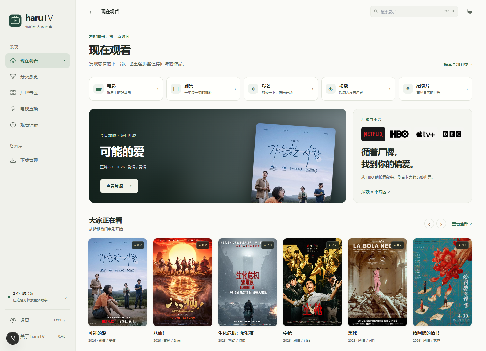

# haruTV

留一点时间，给好故事。Windows 桌面影视发现与播放应用。

- 内容优先的首页：电影、剧集、动漫、综艺、纪录片等 8 组推荐。
- 分类浏览：内容类型、题材、地区、年代、评分和排序组合筛选。
- 厂牌作品目录：4,607 条公开关系记录，Netflix、HBO、Apple TV+、BBC、A24、吉卜力、皮克斯、漫威影业，真实 Logo，支持全目录搜索与分页。
- 聚合搜索、跨源合并、点播与直播、续播、观看记录、下载及缓存。
- LIBVIO 桌面网页源：关键词搜索、播放页链接识别、网页线路选择与官方播放器嵌入。
- 固定侧栏、浅色 / 深色 / 跟随系统外观、键盘操作与减少动态效果。



## 下载

Windows 安装包见 [Releases](https://github.com/scj040921/haruTV/releases)。当前版本为开发预览。

安装后从桌面 haruTV 快捷方式启动。本地服务与访问凭证由应用自动管理。

## 开发

需要 Node.js 22 或更新版本，Windows x64。

```powershell
npm ci
npm run build:desktop
npm run desktop
```

生成安装包：`npm run build:win`，产物在 `dist/`。

验证：`npm run typecheck`、`npm run lint`、`npm test`。

前端调试：配置 `.env.local` 的 `PASSWORD` 后运行 `npm run dev`。详细结构见 [HARUTV.md](HARUTV.md)。

## 目录与片源

厂牌目录基于公开关系记录，包含长片、短片和剧集。它不是任何厂牌的完整或实时目录；有些条目暂无海报、评分、题材或中文译名。目录规模与更新时间显示在应用中。

目录和推荐只用于发现内容。点击海报会搜索用户添加的片源；收录与品牌标识不代表可播放、播放授权或实际 4K / HDR。用户的账号、观看记录、设置及缓存保存在本机，不随源代码或安装包公开。

## 许可与致谢

本项目采用 [AGPL-3.0-or-later](LICENSE)。代码归属、修改声明及第三方项目见 [NOTICE.md](NOTICE.md)；目录资料许可见 [DATA-LICENSE.md](DATA-LICENSE.md)；Logo 原始来源见 [public/brands/sources.json](public/brands/sources.json)。

维护者可使用 `python scripts/refresh-brand-directory.py --write` 更新目录快照；脚本在数据不完整时保留现有快照，不读取任何账号凭证。

## LIBVIO 网页点播

桌面版预置 `LIBVIO · 网页点播`。它是独立网页适配，不是 CMS API；仅支持 `https://www.libvio.in`。可以搜索片名，也可以在搜索框粘贴该站 `/w/编号-线路-集数.html` 播放页。

第一次使用会让站点在独立、隔离的网站会话中完成其正常验证；需要用户操作时显示官方页面。网站会话仅保存在本机，不导出、不随安装包或源代码公开。适配器不会点击、解算或修改验证，也不会执行远程 Spider/JAR。

视频在保留真实网站来源与会话的沙盒网页播放器中播放，不伪造视频来源请求头。应用支持线路选择、选集和观看进度；网页源暂不支持应用内下载和本机跳过标记。网盘面板不导入。站点结构和可用线路可能变化，本功能为预览。
